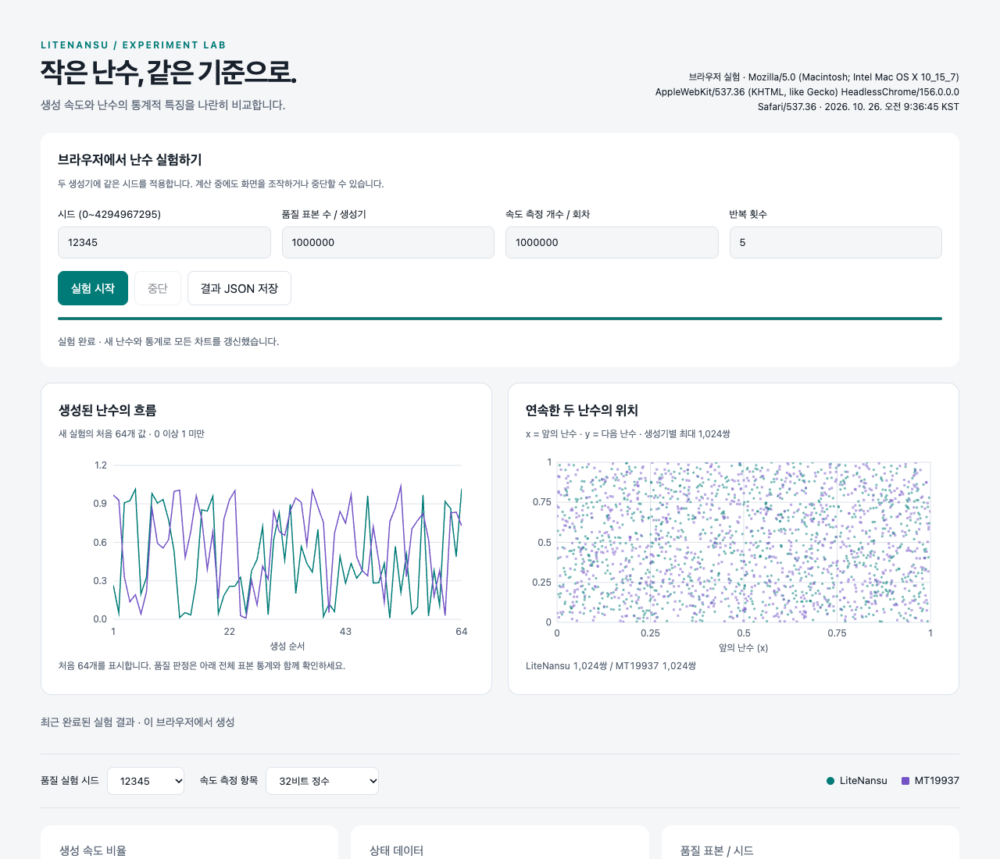

# LiteNansu

**TypeScript 난수 생성기와 브라우저에서 실행하는 난수 실험**

게임·시뮬레이션용 작은 생성기를 구현하고, MT19937과 생성 속도 및 초기 통계 품질을 같은 조건에서 비교합니다. 외부 패키지나 서버 없이 동작합니다.

> LiteNansu는 **xoshiro128\*\*** 기반 구현입니다. 새로운 난수 알고리즘이 아닙니다.



## 바로 실행

### 브라우저

1. 저장소를 내려받거나 복제합니다.
2. 루트의 **`index.html`**을 최신 브라우저에서 엽니다.
3. 시드·표본 수·반복 횟수를 설정하고 **실험 시작**을 누릅니다.

실제 난수 생성, 속도 측정과 품질 검사가 실행됩니다. 진행률과 난수 미리보기를 표시하고, 완료되면 차트를 갱신합니다. **중단** 후 재시작하거나 **결과 JSON 저장**으로 결과를 내려받을 수 있습니다.

Web Worker, Canvas, Blob URL, `light-dark()`를 지원하는 브라우저가 필요합니다. 인터넷 연결은 필요하지 않습니다. 새로고침하면 포함된 예시 결과로 돌아가므로 새 결과는 JSON으로 저장하세요.

### Node.js

**Node.js 24 이상**이 필요합니다. 의존 패키지가 없어 `npm install`은 필요하지 않습니다.

```sh
npm test
npm run experiment
# 짧은 실험
npm run experiment -- --samples 100000 --count 1000000 --rounds 5 --seed 12345
```

결과는 `results/report.json`, `results/summary.md`에 저장하며 `index.html`도 자동 갱신합니다. 기존 파일은 덮어씁니다. Node는 입력 시드와 0·1·4294967295를 중복 없이 검사하며, 브라우저는 입력한 시드 하나로 비교합니다.

## 기능

- **생성기:** xoshiro128** 기반 LiteNansu와 MT19937.
- **API:** uint32, 0~1 실수, 범위 정수, 시드 재현, LiteNansu 상태 저장·복원.
- **속도:** 세 출력 형식, 예열, 실행 순서 교대, 중앙값과 개별 측정값 저장.
- **품질:** 바이트 분포, 비트 균형, 간격별 상관, 주사위 빈도, 원주율 추정.
- **차트:** 난수 흐름, 산점도, 처리량, 회차별 변동과 통계 비교.
- **내보내기:** 실험 JSON과 원시 uint32 스트림.

## TypeScript에서 사용

```ts
import { LiteNansu } from './src/rng.ts';

const rng = new LiteNansu(12345);
rng.nextUint32(); // 0 이상 2^32 미만의 정수
rng.random();     // 0 이상 1 미만의 실수, 32비트 해상도
rng.int(6) + 1;   // 주사위: 1~6

const snapshot = rng.getState();
const restored = LiteNansu.fromState(snapshot);
// rng와 restored는 이후 같은 출력 순서를 만듭니다.
```

시드는 0~4294967295 정수, `int(maxExclusive)`의 인수는 1~4294967296 정수입니다. 범위 정수는 거부 샘플링으로 단순 나머지 매핑의 편향을 제거합니다.

TypeScript는 Node 24의 타입 제거 기능으로 실행합니다. 실행 자체가 정적 타입 검사를 수행하지는 않습니다. 이 저장소는 npm 배포 패키지나 컴파일된 JS 라이브러리를 제공하지 않습니다.

## 비교 기준

| 항목 | LiteNansu | MT19937 |
|---|---|---|
| 기반 알고리즘 | xoshiro128** | MT19937 |
| 상태 배열 데이터 | 16바이트 | 2,496바이트 |
| 정수 출력 | 32비트 | 32비트 |
| 입력 시드 | 32비트 정수 | 32비트 정수 |
| 동일 시드 재현 | 지원 | 지원 |
| 상태 저장·복원 API | 지원 | 미제공 |

메모리는 상태 배열 데이터만 나타내며 객체 부가 비용은 제외합니다. 속도는 기기와 실행 환경에 따라 달라집니다. 포함된 결과는 하나의 환경에서 측정한 예시이며 보편적인 성능 보장이 아닙니다.

품질 검사는 결함 탐색을 위한 초기 진단입니다. 전문 통계 검사, 주기 증명, 독립 스트림 보장을 대체하지 않습니다. [실험 방법과 해석](docs/EXPERIMENTS.md)을 참고하세요.

## 명령어

| 명령어 | 기능 |
|---|---|
| `npm test` | 벡터·재현성·통계·브라우저용 코드 일치 검사 |
| `npm run experiment` | Node 속도·품질 실험과 HTML 갱신 |
| `npm run build` | 현재 결과와 소스로 HTML 생성 |
| `npm run dashboard` | `build`와 동일 |
| `npm run check` | HTML이 현재 소스·결과와 일치하는지 검사 |

로그 없이 원시 uint32 little-endian 데이터를 저장하려면 직접 실행합니다.

```sh
# 1천만 개 uint32, 약 40MB
node src/export.ts litenansu 12345 10000000 > stream.bin
```

## 프로젝트 구조

```text
litenansu/
├── index.html                 # 바로 열 수 있는 독립 실행 HTML
├── src/
│   ├── rng.ts                 # 생성기와 공통 API
│   ├── quality.ts             # Node·브라우저 공통 품질 계산
│   ├── experiment.ts          # Node 비교 실험
│   ├── browser-worker.ts      # 브라우저 실험
│   ├── dashboard.html         # 화면 원본
│   ├── dashboard.ts           # HTML 생성과 일치 검사
│   └── export.ts              # 원시 데이터 출력
├── test/                      # 자동 검사
├── results/                   # 예시 실험 결과
├── docs/                      # 실험 해석과 화면 예시
└── .github/workflows/ci.yml    # 자동 검증
```

화면은 `src/dashboard.html`을 수정한 뒤 `npm run build`를 실행하세요. 생성된 `index.html`도 함께 커밋합니다. 생성기 추가는 [기여 안내](CONTRIBUTING.md)를 참고하세요.

## 문서와 라이선스

- [실험 방법과 해석](docs/EXPERIMENTS.md)
- [기여 안내](CONTRIBUTING.md)
- [변경 이력](CHANGELOG.md)
- [MIT 라이선스](LICENSE)
- [외부 알고리즘 고지](THIRD_PARTY_NOTICES.md): xoshiro128** CC0, MT19937 BSD-style three-clause notice.

알고리즘 출처: [Blackman·Vigna의 PRNG 자료](https://prng.di.unimi.it/), [논문](https://vigna.di.unimi.it/ftp/papers/ScrambledLinear.pdf), [MT19937 공식 페이지](https://www.math.sci.hiroshima-u.ac.jp/m-mat/MT/emt.html).
